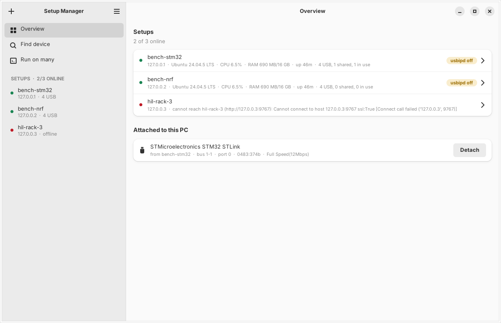
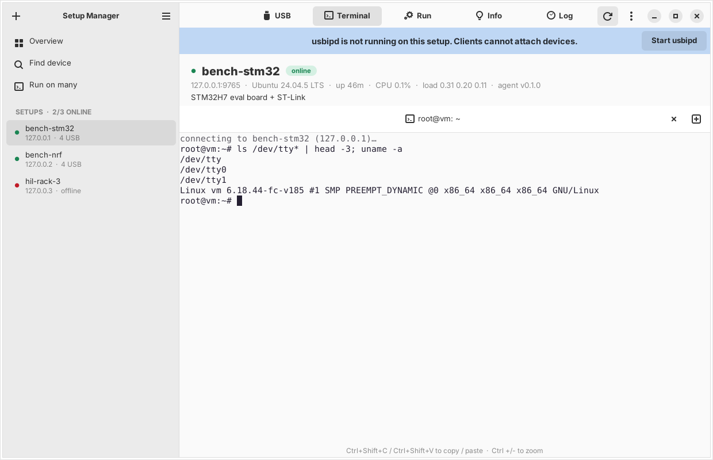
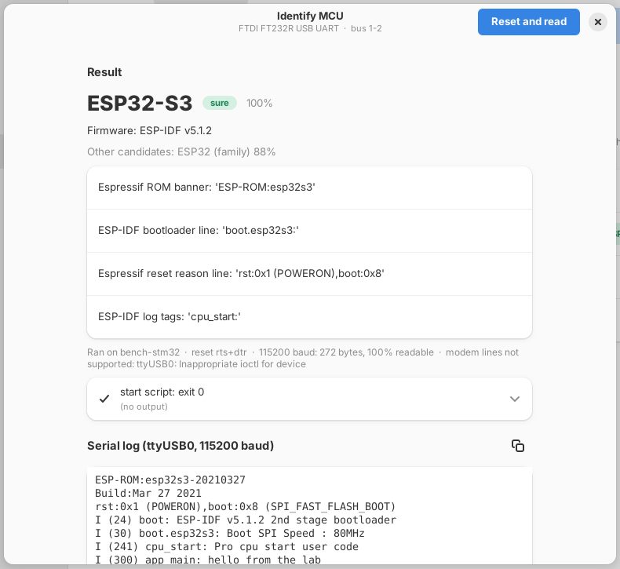
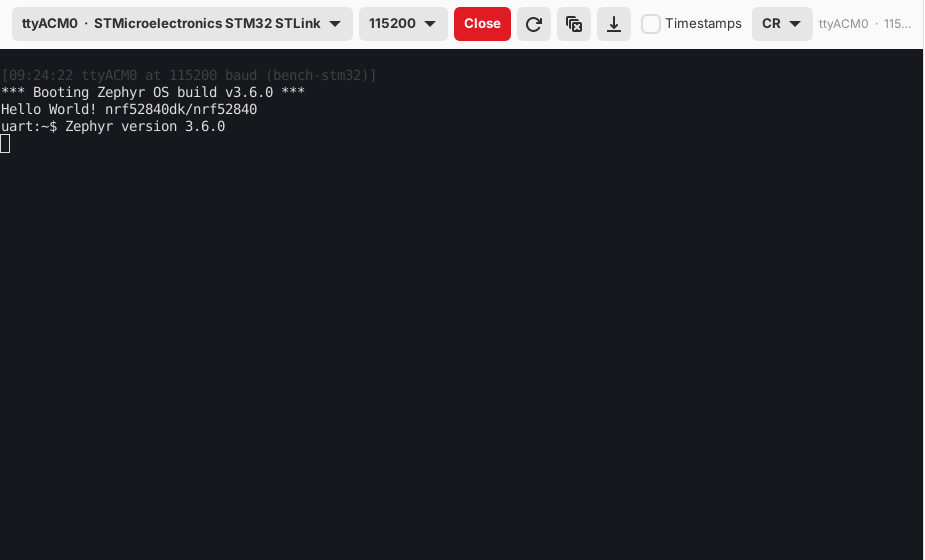
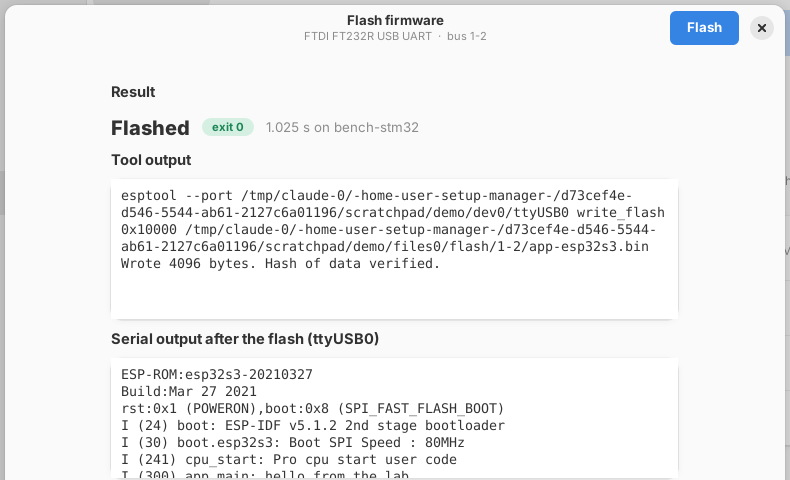

# Setup Manager

Setup Manager is an Ubuntu desktop app that controls a group of Linux "setup
PCs" that you use for embedded development. Each setup PC shares its USB
devices (debug probes, serial adapters, boards) over USB/IP. With Setup
Manager, you can:

- See the status of all setup PCs (online, CPU, memory, disk, IPs, usbipd).
- See the USB devices of each PC, with their tty names and USB/IP state.
- Attach a device to your PC with one click (usbip bind + usbip attach).
- Keep a device attached. The app attaches it again after a board reset.
- Open real terminal tabs on a setup PC, or run one command on many PCs.
- Reset a board, read its boot log and see which MCU it probably is, next to the device.
- Watch the serial port of a board live, flash firmware, see who uses a device, and give devices names.
- Automate it all from Python (scripts, CI, pytest), with reservations so that jobs do not use the same board.
- Let AI agents do all of this through an MCP server.


## Parts

```
 your Ubuntu PC                                   setup PC (one agent on each)
 +-----------------------------+   HTTP + WS     +-------------------------------+
 | Setup Manager app (GTK 4)   | --------------> | setup_agent.py  (systemd)     |
 | setup-manager mcp    (MCP)  |   token auth    |   status, USB list, bind,     |
 | setup-manager <cli>         |   port 8765     |   exec, PTY shell             |
 |                             |                 |                               |
 | usbip attach / detach       | <-------------- | usbipd (USB/IP server)        |
 +-----------------------------+   USB/IP 3240   +-------------------------------+
```

| Part | Runs on | What it is |
|---|---|---|
| Agent | each setup PC | `setup_manager/agent/setup_agent.py`. One file. Python 3.8+ standard library only. Runs as root (USB bind needs root) from systemd and starts at boot. |
| App | your Ubuntu PC | A native GTK 4 + libadwaita app. The terminal tabs use VTE (the terminal of GNOME Terminal). The local `usbip attach` runs here. |
| CLI and MCP | your Ubuntu PC | The `setup-manager` command. Same logic as the app. |

The app, the CLI and the MCP server use the same config file:
`~/.config/setup-manager/config.json`.

## 1. Install the app (your Ubuntu PC)

Requirements: Ubuntu 24.04 or newer (libadwaita 1.5 or newer).

```bash
git clone https://github.com/alonlot/setup-manager- setup-manager
cd setup-manager
./install-app.sh
```

Run it as your normal user (not with sudo). It asks for your sudo password. The script:

- Installs the system packages: GTK 4, libadwaita, VTE, PyGObject, and the usbip client (`linux-tools-generic`).
- Makes a Python venv in `~/.local/share/setup-manager/venv` that uses the system GTK bindings.
- Installs the command `~/.local/bin/setup-manager`.
- Adds **Setup Manager** to the app menu (with an icon).
- Adds a sudo rule (`/etc/sudoers.d/setup-manager`). The rule lets you run `usbip` and `modprobe vhci-hcd` without a password, because `usbip attach` needs root.
- Loads the `vhci-hcd` kernel module now and at boot.

Run `./install-app.sh` again to upgrade. Use `./install-app.sh --uninstall` to remove it (your config is kept).

## 2. Install the agent (each setup PC)

### From your PC, over SSH (recommended)

```bash
setup-manager deploy dev@192.168.1.20 --name bench-1 --install-deps
```

This copies the agent to the PC, runs the installer with sudo, and adds the
setup to the app with its token. To use one token for all setups, set the
default agent token in **Preferences** first, or give `--token`.
Repeat for each setup PC.

### By hand

Copy the folder `setup_manager/agent/` to the setup PC (`setup-manager agent-files` prints its path), then:

```bash
sudo ./install.sh --name bench-1 --install-deps
```

The installer:

- Copies the agent to `/opt/setup-agent/` and makes `/etc/setup-agent/config.json`.
- Makes a random token if you do not give one, and prints it as `CONFIG_TOKEN=...`.
- Installs and starts two systemd services: `setup-agent` and `setup-usbipd`. They start at boot.
- Loads `usbip-host` at boot.
- Sets the shell user to the user that ran sudo (`run_as`). Shells and commands run as this user, not root.
- Makes a TLS certificate for this PC and prints its fingerprint as `CONFIG_FINGERPRINT=...`.
- Blocks USB/IP (port 3240) from the network: USB/IP goes through the encrypted agent port.
- Opens the agent port in ufw when ufw is active (8765/tcp, 8765/udp).

Options: `--token`, `--port`, `--run-as USER`, `--auto-bind RULE`, `--protect RULE`, `--install-deps`,
`--plain` (no TLS: NOT encrypted), `--open-usbip` (keep port 3240 open: USB/IP NOT encrypted).
Run `install.sh` again to upgrade. It keeps the existing config. To remove: `sudo ./uninstall.sh [--purge]`.

Check the agent on the setup PC: `systemctl status setup-agent` and `journalctl -u setup-agent -f`.

When you update Setup Manager, update the agents too (run `setup-manager deploy` again). An old agent
does not have the new features: the app then says "the agent on ... is too old for this".

## 3. Use the app

Open **Setup Manager** from the app menu, or run `setup-manager`.
Add setups with **+** (host and token) or with **Scan network** in the main menu
(UDP broadcast, same subnet only).

| Place | What you can do |
|---|---|
| Overview | All setups with CPU, RAM and USB counts. The devices attached to your PC, with Detach. The keep-attached list. |
| Setup > USB | One row per device: state, name, vid:pid, serial, tty names, drivers. **Attach** shares the device and attaches it to your PC. **Detach** detaches it and stops sharing. The **⋮** menu: share only, stop sharing, detach and keep shared, keep attached, auto-share when plugged, USB reset, copy bus ID, copy the usbip command. |
| Setup > Terminal | Real terminal tabs (VTE) on the setup PC. **+** opens a new tab. A tab stays open when you go to other pages. Ctrl+Shift+C / Ctrl+Shift+V copy and paste. Ctrl +/- zooms. |
| Setup > Run | Run one command with a timeout and an optional user. Quick commands (right-click a quick command to remove it). |
| Setup > Info / Log | System details, and the recent log lines of the agent. |
| Find device | Find a device on all setups by name, vid:pid, serial or tty. |
| Run on many | Run one command on many setups at the same time. |
| Preferences (Ctrl+,) | Default agent token and port, refresh interval, the local usbip command and sudo. |

Keyboard: Ctrl+N add setup, Ctrl+R or F5 refresh, Ctrl+Q quit.



Device states:

| State | Meaning |
|---|---|
| Not shared | The setup PC uses the device. |
| Shared | Bound to usbip-host. No client has it. |
| Attached here | Attached to this PC. |
| In use elsewhere | Another client has it. **Take over** takes it (asks first). |

### Keep attached and auto-share

Debug probes and boards often re-enumerate (after flashing, after a reset).
Then the USB/IP connection drops.

- **Keep attached** (your PC): every 4 seconds, the app checks the device and attaches it again when it is missing. It follows the device by serial number when it moves to a different USB port. This works while the app is open. To keep it without the app, run `setup-manager daemon` (for example as a systemd user service). Do not run the app and the daemon at the same time. A manual Detach turns keep-attached off.
- **Auto-share when plugged** (setup PC): the agent binds matching devices by itself when they are plugged in. The rules are in the agent config (`auto_bind`).

Use the two together for a hands-off setup.

### Safety rules in the agent

- The agent does not bind a device that has a network interface (a USB Ethernet adapter can be the only link to the PC), a hub, or a device in `protected`. The app asks before it forces this.
- Rule format for `auto_bind` and `protected`: `1-1.2` (busid), `0483:374b` (vid:pid), `0483:*`, `0483:374b:SERIAL`.



## Identify the MCU

Setup Manager can find which MCU is on a board. Open the **⋮** menu of a
device and select **Identify MCU…**, then click **Reset and read**. The app:

1. Opens the serial port(s) of the device and starts to record.
2. Runs your **start script**, if you have one.
3. Resets the MCU.
4. Runs your **after-reset script**, if you have one, while it records.
5. Records for the capture time (4 seconds by default). With baud rate "auto", it tries
   115200, 74880, 9600 and 57600 until the text is readable.
6. Compares the log, the USB IDs, the debug probe output and the script output with known signatures.

The result shows next to the device:

| Label | Meaning |
|---|---|
| `ESP32-S3` (green) | Sure. A strong signature, clearly ahead of the other candidates. |
| `STM32?` (amber) | Probably. Hover over the label to see the evidence. |
| `ESP32?` (grey) | A weak guess, for example only from a USB bridge chip. |

Click the label to see the full result and the log, or to run it again.



### Reset methods

| Method | What it does | For |
|---|---|---|
| `auto` | Selects a method from the USB IDs | Start with this |
| `rts` | Pulses RTS (the EN pin), like esptool | ESP32, ESP8266, ESP32 native USB |
| `dtr` | Pulses DTR | Arduino Uno, Mega, Nano |
| `rts+dtr` | RTS, then DTR | Unknown CH340/CP210x/FTDI boards |
| `repl` | Sends Ctrl-C, Ctrl-D (soft reset) | MicroPython, CircuitPython |
| `probe` | `st-flash reset` or `pyocd reset`, and reads the chip type with `st-info` | ST-LINK, CMSIS-DAP, DAPLink |
| `usb` | USB port reset of the device | Native USB devices |
| `none` | No reset. Your scripts do it. | J-Link, nrfjprog, relays, special boards |

### It recognizes

Espressif ROM and ESP-IDF logs (all ESP32 types, ESP8266), RP2040/RP2350 and
MicroPython/CircuitPython banners, Zephyr and nRF Connect SDK boot lines and
board names, U-Boot and Linux SoC lines, `st-info` output, `nrfjprog`
output, chip names in any text (STM32, nRF, ATmega, SAMD, GD32, CH32V, LPC,
i.MX RT, EFR32, CC13xx/CC26xx, MSP430, PSoC, Kinetis and more), and the USB
IDs of common boards and probes. It also shows the firmware when it finds it
(ESP-IDF, Zephyr, MicroPython, U-Boot, Linux, FreeRTOS, Arduino and more).
To add a signature, edit `setup_manager/mcu_detect.py`. The agents do not need an update for this.

### Scripts: make the right logs appear

Some boards print nothing at boot, or the MCU name is only in a command
output. Use the scripts to fix this:

- **Start script**: runs before the reset. For example: put the board in a mode, power it on with a relay, or read the chip with a tool.
- **After-reset script**: runs after the reset, while the app records. For example: wait for the prompt and send a command.

The scripts run with bash on the PC that has the serial port, with these variables:

| Variable | Value |
|---|---|
| `SM_TTY` | The first serial port, for example `/dev/ttyACM0` |
| `SM_TTYS` | All serial ports of the device |
| `SM_BAUD` | The baud rate of this try |
| `SM_BUSID`, `SM_VID`, `SM_PID`, `SM_SERIAL` | The USB device |
| `SM_PHASE` | `start` or `after_reset` |
| `SM_SETUP` | The name of the setup |

The output of the scripts also counts for the guess. A script that prints
`NRF52840_xxAA` (for example `nrfjprog --deviceversion`) is enough.
Examples:

```bash
# after reset: ask a Zephyr shell
sleep 2; printf '\rkernel version\r' > "$SM_TTY"

# after reset: ask your own firmware
sleep 1; printf 'version\r' > "$SM_TTY"

# start: J-Link without a serial port, print the core and reset
printf 'connect\nr\ng\nexit\n' > /tmp/jl.txt
JLinkExe -USB "$SM_SERIAL" -if SWD -speed 4000 -device CORTEX-M4 -autoconnect 1 -CommandFile /tmp/jl.txt
```

Do not read from `$SM_TTY` in a script: the app reads the port, and a script that also reads it takes the bytes.

### Profiles

A profile stores the reset method, the baud rate, the capture time and the
two scripts. There are built-in profiles (Auto, ESP32 / ESP8266, Arduino,
MicroPython, Zephyr shell, U-Boot / Linux, ST-LINK, nRF with nrfjprog). Click
**Save as profile…** to save your own. The app remembers the last options for
each device.

### Where it runs

| Device state | What happens |
|---|---|
| Not shared | The agent on the setup PC does it. |
| Attached here | This PC does it, with the local serial port. |
| Shared, no client | The app stops sharing, does it on the setup PC, then shares it again. |
| In use elsewhere | Refused. Identify it on the other PC, or take it over. |

The installers add the shell user to the `dialout` group, so that the scripts can open the serial ports.

### Limits

- The result is a guess from text. A board that prints nothing and has a generic USB bridge gives only a weak guess. Then use a script.
- `rts` and `dtr` reset only work when the board connects these lines to reset (most ESP32 and Arduino boards do).
- `probe` needs `st-flash`/`st-info` (package `stlink-tools`) or `pyocd` on the PC that runs it.

## Serial monitor

Open the **Serial** tab of a setup, or select **Serial monitor** in the **⋮**
menu of a device. Select the port and the baud rate, then click **Open**.

- The agent keeps the port open and records it (2 MB per port). The app, the CLI and your AI agents can read the same port at the same time. Each reader has its own position.
- When the board re-enumerates (after a flash or a reset), the port opens again by itself. The log shows `[port disconnected]` and `[reconnected]`.
- Type in the black area, or in the line field below it. Select what Enter sends (CR, LF, CR LF).
- Buttons: reset the board (method `auto`), clear the view, save the log to a file. Turn on **Timestamps** to see the time of each line.
- A port that nobody reads for 15 minutes closes (`serial_idle_timeout` in the agent config).
- For a device that is attached to your PC, the monitor uses its local port.



CLI: `setup-manager serial bench-1 1-1` (Ctrl-] exits). In a script:
`setup-manager serial bench-1 1-1 --read-only --wait-for "boot OK" --timeout 30` exits with 0 when the text comes, and with 1 when the time is over.

## Files and flashing

Select **Flash firmware…** in the **⋮** menu of a device. Select the file and a profile, then click **Flash**.

1. The app copies the file to the setup PC (`/var/lib/setup-agent/files/flash/<busid>/`).
2. It pauses the serial monitor of the device, because flash tools need the port alone.
3. It runs the profile script on the setup PC.
4. It shows the tool output, and the serial output of the new firmware for some seconds.

Built-in profiles: esptool, st-flash, OpenOCD, pyOCD, nrfjprog, J-Link Commander, picotool, avrdude, dfu-util,
and "copy to a USB drive" (DAPLink, UF2). The app selects one from the USB IDs and the MCU result, and
remembers the last options for each device. Edit the script and the variables, and **Save as profile…**.

| Variable | Value |
|---|---|
| `SM_FILE`, `SM_FILE_EXT` | The firmware on the setup PC, and its extension (`bin`, `hex`, `elf`, `uf2`) |
| `SM_TTY`, `SM_TTYS` | The serial port(s) of the device |
| `SM_SERIAL`, `SM_VID`, `SM_PID`, `SM_BUSID` | The USB device (`SM_SERIAL` selects the probe in st-flash, pyOCD, J-Link, nrfjprog) |
| Your variables | For example `SM_TARGET=target/stm32h7x.cfg`, `SM_OFFSET=0x10000` |

The flash tools must be installed on the setup PC. The script runs as the shell user of the agent (`run_as`). Tools that use USB directly (st-flash, OpenOCD, pyOCD, J-Link, picotool) need their udev rules for that user. The packages of most tools install them.

For a device that is attached to your PC, the script runs on your PC with your local file.



CLI:

```bash
setup-manager flash bench-1 1-2 build/zephyr/zephyr.hex                # the last profile of this device
setup-manager flash bench-1 1-1 fw.bin --profile "st-flash (STM32, ST-LINK)" --monitor 5
setup-manager flash bench-1 1-1 fw.elf --profile OpenOCD --env SM_TARGET=target/stm32h7x.cfg
setup-manager upload bench-1 data.bin           # to the agent's files folder
setup-manager download bench-1 /var/log/syslog .
setup-manager files bench-1
```

## Who uses a device

When a device is in use by another client, the row says who, for example
`in use by alice@lab-pc (192.168.1.33)`. The Take over dialog shows the name too.

- Each Setup Manager tells the agent its name when it attaches a device. The name is `user@hostname`, or the name in **Preferences**.
- For other clients (for example a manual `usbip attach`), the agent finds the IP address from the TCP connections on port 3240, and the host name from DNS when possible.

## Device names

Select **Rename…** in the **⋮** menu to give a device a nickname, for example
"Board A, STM32H7 rev2". The nickname replaces the title, and the real name
moves to the second line. The agent stores it with the USB serial number
(or the port when there is no serial number), so every manager in the lab sees
the same names. Search finds devices by nickname too.

CLI: `setup-manager rename bench-1 1-1 Board A`.

## Python library (automation)

Use Setup Manager from your own Python code: scripts, CI jobs and pytest. It is
another way to connect. It uses the same config file and the same setups as the
app, and it changes nothing in the app, the CLI or the MCP server.

```python
from setup_manager import Lab

with Lab() as lab:                                # Lab(config="lab.json") or Lab(setups=[{"host": ..., "token": ...}])
    board = lab.device("Board A")                 # nickname, serial number, "bench-1:1-2", "0483:374b", or name words
    with board.reserve(owner="ci-42", ttl=600, wait=120):   # a lock on the board
        with board.serial(115200) as con:         # open before the flash, so you get the boot output
            board.flash("build/zephyr.hex")       # the last profile of this board, or profile="...", env={...}
            con.expect(r"boot OK", timeout=10)    # re.Match, or ExpectTimeout with the output
            con.send("version")                   # CR LF is added; end="" for none
            print(con.expect(r"v(\d+\.\d+)").group(1))
    with board.attached():                        # attach to this PC, detach at the end (also on an error)
        print(board.local_ttys)                   # for example ["/dev/ttyACM3"]
    print(lab.setup("bench-1").run("uname -a").check().stdout)
```

| Object | Main methods and properties |
|---|---|
| `Lab` | `setups()`, `setup(ref)`, `devices(query, setup=)`, `device(ref, setup=)`, `reservations()`, `add_setup(host, token)`, `close()` |
| `Setup` | `run(cmd, timeout, user, check)`, `upload()`, `download()`, `files()`, `status()`, `online()`, `devices()` |
| `Device` | `reserve()`, `attach()`, `detach()`, `attached()`, `flash()`, `identify()`, `reset()`, `serial()`, `console`, `bind()`, `unbind()`, `usb_reset()`, `set_name()`, `refresh()`; `busid`, `display_name`, `serial_number`, `ttys`, `local_ttys`, `state`, `used_by`, `reserved_by`, `mcu` |
| `SerialConsole` | `expect(regex, timeout)`, `send(text, end)`, `write(bytes)`, `read(timeout)`, `read_for(seconds)`, `lines()`, `clear()`, `log` |
| Results | `CommandResult` (`ok`, `check()`), `FlashResult`, `IdentifyResult` |
| Errors | `LabError`, `DeviceNotFound`, `AmbiguousDevice`, `BoardBusy`, `FlashFailed`, `CommandFailed`, `ExpectTimeout` |

- The API is synchronous. It also works in Jupyter.
- A `Device` follows the board by its USB serial number. When the board moves to another USB port, the next call finds it again.
- `lab.device(...)` raises `AmbiguousDevice` (with the candidates) when more than one device matches.

### Reservations

`device.reserve()` locks a device on its setup PC. While it is reserved, only the
owner can bind, unbind, reset, identify or flash it, or write to its serial
port. This also applies to the app, the CLI and the MCP server: they get the
error "reserved by ci-42 until 12:30". Everybody can still read the serial port.

- The reservation renews itself while your program runs. If the program dies, it ends after `ttl` seconds.
- `wait=` waits for a board that somebody else has. Without it, you get `BoardBusy` at once.
- A device that is not reserved works as before.
- A device that is already shared over USB/IP can still be attached with `usbip attach` by hand. USB/IP itself has no locks. Reserve a board before you share it.

Reservations need agent 0.3.0 or newer: run `setup-manager deploy` again.

### pytest

The plugin is opt-in. Enable it with `-p setup_manager.pytest_plugin`, or with
`pytest_plugins = ["setup_manager.pytest_plugin"]` in your `conftest.py`.

```python
import pytest

@pytest.mark.board("Board A")                   # reserved for this test, released after it
def test_boot(board):
    board.flash("build/zephyr.hex")
    board.console.expect("boot OK", timeout=10)
```

```bash
pytest -p setup_manager.pytest_plugin tests/hil --lab-owner ci-runner-1 --lab-wait 600
```

- Fixtures: `lab` (one per session) and `board` (from the `board` marker).
- Marker arguments: `board(ref, setup=None, reserve=True, ttl=600, wait=None, baud=115200)`.
- Options: `--lab-config`, `--lab-owner`, `--lab-wait`.
- When a test fails, the serial output of its boards is added to the pytest report.

See `examples/flash_and_check.py` and `examples/test_hil_example.py`.

## 4. Connect AI agents (MCP)

The MCP server uses the same config and the same logic as the app. Devices
attach to the PC where the MCP server runs.

Claude Code:

```bash
claude mcp add setup-manager -- ~/.local/bin/setup-manager mcp
```

Claude Desktop, Cursor and other clients (stdio):

```json
{
  "mcpServers": {
    "setup-manager": {
      "command": "/home/you/.local/bin/setup-manager",
      "args": ["mcp"]
    }
  }
}
```

For clients that use HTTP: `setup-manager mcp --http --port 8801` (streamable HTTP at `http://127.0.0.1:8801/mcp`). It has no auth. Keep it on 127.0.0.1.

Tools:

| Tool | What it does |
|---|---|
| `list_setups` | All setups with online state and USB counts |
| `setup_status` | Full status of one setup |
| `list_usb` | USB devices of a setup and their state |
| `find_usb` | Search devices on all setups (`"stlink"`, `"0483:374b"`, `"ttyACM"`) |
| `attach_usb` / `detach_usb` | Bind + attach here / detach + unbind |
| `bind_usb` / `unbind_usb` / `reset_usb` | Single actions on the setup PC |
| `keep_attached` | Turn keep-attached on or off |
| `list_attached` | Devices attached to this PC |
| `run_command` / `run_command_many` | Shell commands on one or many setups |
| `identify_mcu` | Reset the MCU, read its log and guess the MCU (with profiles and scripts) |
| `identify_profiles` / `save_identify_profile` | List and save identify profiles |
| `serial_ports` / `serial_open` / `serial_close` | Serial ports of a setup, open (records from now on) and close |
| `serial_read` | New serial output since your last read (or from an offset) |
| `serial_write` | Send text (CR LF added by default) |
| `serial_wait_for` | Wait until the output matches a regular expression |
| `serial_reset` | Reset the board through the open port |
| `flash_firmware` / `flash_profiles_list` | Flash a file from this PC with a profile, and return the boot output |
| `upload_file` / `download_file` / `list_files` | Copy files to and from a setup PC |
| `set_device_name` | Give a device a nickname |
| `agent_log` | Recent agent log lines |

Example requests to an agent: *"Flash build/zephyr.hex to Board A, then check
that it prints 'boot OK' within 10 seconds."* (the agent uses serial_open,
flash_firmware, serial_wait_for), *"Find the ST-Link on the lab setups, attach it,
flash build/fw.elf with openocd, then detach it."* or *"Identify the MCU on
every USB serial device of bench-2."*

## CLI

```bash
setup-manager                            # open the app
setup-manager list                       # setups and state
setup-manager usb bench-1                # USB devices
setup-manager attach bench-1 1-1.2       # bind + attach here
setup-manager detach bench-1 1-1.2       # detach + unbind (--keep-bound to keep it shared)
setup-manager attached                   # devices attached to this PC
setup-manager shell bench-1              # interactive shell in this terminal (like ssh)
setup-manager exec bench-1 'dmesg | tail -n 20'
setup-manager exec all -- uptime         # on every setup
setup-manager identify bench-1 1-2       # reset, read the log, guess the MCU
setup-manager identify bench-1 1-2 --profile "Zephyr shell" --log
setup-manager identify bench-1 1-2 --reset none --script start.sh --after-script ask.sh
setup-manager identify --list-profiles
setup-manager serial bench-1 1-1                 # serial terminal (Ctrl-] exits)
setup-manager flash bench-1 1-1 fw.hex           # flash with the last profile of the device
setup-manager rename bench-1 1-1 Board A         # nickname
setup-manager discover                   # find agents with UDP broadcast
setup-manager add 192.168.1.21 --name bench-2 --token ...
setup-manager daemon                     # keep-attached without the app
setup-manager --json usb bench-1         # JSON output for scripts
```

A setup can be given by id, name or host.

## Configuration

App (`~/.config/setup-manager/config.json`). You can change most values in the app. All keys are optional:

```json
{
  "agent_defaults": { "port": 8765, "token": "one-token-for-all-agents" },
  "local_usbip": { "command": null, "sudo": null },
  "poll_interval": 5,
  "discovery_targets": ["255.255.255.255"],
  "setups": [
    { "id": "bench-1", "name": "bench-1", "host": "192.168.1.20", "port": 8765, "token": "...",
      "fingerprint": "9e09c394…", "transport": "auto", "usbip_port": 3240, "notes": "STM32H7 board" }
  ]
}
```

Agent (`/etc/setup-agent/config.json`): see `setup_manager/agent/config.example.json`.
Important keys: `token`, `port`, `run_as`, `auto_bind`, `protected`, `tls_cert`/`tls_key`, `discovery`.
Restart after a change: `sudo systemctl restart setup-agent`.

## Update everything (this PC and all setup PCs)

```bash
cd setup-manager
./update-lab.sh --dry-run      # see the plan first
./update-lab.sh                # do it
```

The script:

1. Updates this PC: `git pull`, then `./install-app.sh` (the app, the command, the sudo rule, dialout).
2. Runs `setup-manager rollout`. For each setup PC, one after the other, it:
   - copies the agent over SSH and installs it with sudo (with `--install-deps`, so usbip is installed when it is missing);
   - gives the PC a **new unique random token** (32 bytes);
   - saves the token and the **TLS fingerprint** (read over SSH, so the pin is safe) in your config;
   - waits for the agent, and checks the version, TLS, the USB/IP tunnel, usbip and usbipd;
   - detaches the devices that are attached to this PC from that setup before the restart, and attaches them again after it.
3. At the end, when all the setup PCs are OK: turns on **Require encryption**, and removes the old shared default token.
4. Checks this PC: usbip, the sudo rule, the vhci-hcd module, the dialout group.

Before it starts, it shows a plan with each PC, its SSH target, its current version, and the devices of
other people that will disconnect (the agent restarts). It asks once for your sudo password on the setup
PCs (when they need one). It keeps the password in memory only and sends it only over SSH.

**Nothing is lost when a PC fails** (off, wrong password, no network): the new token is saved as
"pending" before the install. Run the same command again: it continues with the same token. The
update uses SSH, not the agent token.

| Option | Effect |
|---|---|
| `--dry-run` | Only show the plan |
| `--only SETUP` | Only these setups (repeatable) |
| `--ssh-user USER` | SSH user for setups without an SSH target yet. The target is saved per setup (`"ssh": "dev@10.0.0.5"`). |
| `--ssh-port N` | Another SSH port for all setups. Without it, the port that `deploy --ssh-port` saved for each setup (`"ssh_port"`), or 22. |
| `--keep-tokens` | Do not change the tokens |
| `--no-install-deps` | Do not install usbip with apt |
| `--no-require-encryption` | Do not turn on Require encryption |
| `--yes` | Do not ask before the update (for scripts) |
| `--skip-manager` | (update-lab.sh only) Do not update this PC |

Tip: use SSH keys (`ssh-copy-id dev@bench-1`). Then only the sudo password is asked, once.
After the update, close the app and open it again.

## Security

### How it connects

```
 your PC (app, CLI, MCP, Lab)                         setup PC
 TLS 1.2+ ──────────────────── TCP 8765 ────────────►  setup-agent
   - API, shell, serial, files: every request has the token
   - USB/IP: a tunnel in the same TLS port ("SMTUNNEL <token>"), relayed to usbipd on 127.0.0.1
 UDP 8765 broadcast (Scan network only) ────────────►  name, port, version, fingerprint (no secrets)
 SSH (setup-manager deploy only) ──── TCP 22 ───────►  install / update the agent
                                                       port 3240 (usbipd): blocked from the network
```

Everything that goes over the network is encrypted: the token, the commands and their output,
the shell, the serial data, the files, and the USB traffic.

| Part | What protects it |
|---|---|
| Encryption | TLS 1.2 or newer on the agent port. The agent makes a self-signed certificate (EC P-256) at the installation. |
| The agent's identity | The app pins the SHA-256 fingerprint of the certificate, like SSH `known_hosts`. A different certificate is refused ("the TLS certificate of ... changed! This can be an attack"). |
| The first connection | `setup-manager deploy` reads the fingerprint over SSH, so the first connection is also safe. When you add a setup by hand, type the `CONFIG_FINGERPRINT` from `install.sh` in the fingerprint field, or the app trusts the certificate at the first connection. |
| Access | A random token for each PC (32 bytes), unless you choose to use one token for all PCs. Without the token, only the name and version are visible. |
| USB/IP | It goes only through the encrypted tunnel, which needs the token. The agent blocks port 3240 from the network with an iptables rule (`setup-agent-usbip`). Reservations also apply to the tunnel. |
| Downgrade | A setup with a pinned fingerprint never uses plain HTTP. |
| Files | The tokens are in files with mode 600 on both sides. The key of the certificate is mode 600. |

**Old agents:** agents before version 0.4 have no TLS. The app still works with them, but shows
"not encrypted" on the setup, and attaches USB/IP without encryption. Run `setup-manager deploy` for
each setup PC to update it. Then turn on **Preferences > Require encryption**, so that the app refuses
any connection that is not encrypted.

**After you reinstall a setup PC** (new certificate): `setup-manager trust bench-1 --forget`, or clear the
fingerprint in **Edit setup**. To check a fingerprint: `setup-manager trust bench-1`, and on the setup PC:
`sudo openssl x509 -in /etc/setup-agent/cert.pem -outform der | sha256sum`.

### What is still your job

- The token gives root-level control of that setup PC (shell, commands as any user). Keep the tokens secret. The app config (`~/.config/setup-manager/config.json`) contains them.
- All users of one token are the same user for the agent. The agent log does not show who did an action.
- "In use by" names and reservations protect against mistakes, not against a person who has the token.
- `setup-manager mcp --http` has no authentication. It listens on 127.0.0.1, so every user who can log in to your PC can use it. The stdio mode (the default) does not have this problem.
- `--plain` and `--open-usbip` turn the encryption off. Use them only on a network that you trust completely.

## Troubleshooting

| Problem | What to do |
|---|---|
| The app does not start: "cannot start the desktop app" | Run `./install-app.sh` again. It installs GTK 4, libadwaita and VTE for the system Python. |
| Setup is offline | On the setup PC: `systemctl status setup-agent`. Check the firewall (8765/tcp). Check host and port in the app. |
| "agent rejected the token" | The token in the app does not match `/etc/setup-agent/config.json`. |
| "usbipd is not running" | Click **Start usbipd** in the banner, or `sudo systemctl restart setup-usbipd` on the setup PC. |
| usbip not found on the setup PC, or bind fails with "usbip not found for kernel ..." | Ubuntu: `/usr/bin/usbip` is a wrapper that needs the tools of the running kernel (after a kernel update too): `sudo apt install linux-tools-$(uname -r)`. Without them, the agent uses the newest `/usr/lib/linux-tools/*/usbip` that it finds; the status shows the path and the hint. Debian: `sudo apt install usbip`. |
| Attach fails with "password is required" | Run `./install-app.sh` again (it adds the sudo rule). |
| Attach fails with "open vhci_driver" | `sudo modprobe vhci-hcd` on your PC. |
| Attach times out | Old agent: port 3240/tcp on the setup PC is blocked. Update the agent (USB/IP then goes through port 8765). |
| "the TLS certificate of ... changed" | You reinstalled the agent: `setup-manager trust SETUP --forget`. If you did not, somebody can be between you and the PC: find out before you trust it. |
| "does not use encryption" | The agent is older than 0.4 or was installed with `--plain`: `setup-manager deploy USER@HOST`. |
| Scan network finds nothing | Discovery uses UDP broadcast and works only in one subnet. Add the setups by IP. |

## Development

```bash
python3 -m venv --system-site-packages .venv   # system Python, for the GTK bindings
.venv/bin/pip install -e '.[test]'
.venv/bin/pytest
```

The tests run a real agent process against a fake sysfs tree with fake `usbip`
programs (`tests/fakes/`). They test the agent API, the manager logic, the
shell client in a real pseudo-terminal and the MCP server, without USB
hardware or root. The app smoke test runs only when a display is available.
The MCP server works with the `mcp` package 1.x and 2.x.
