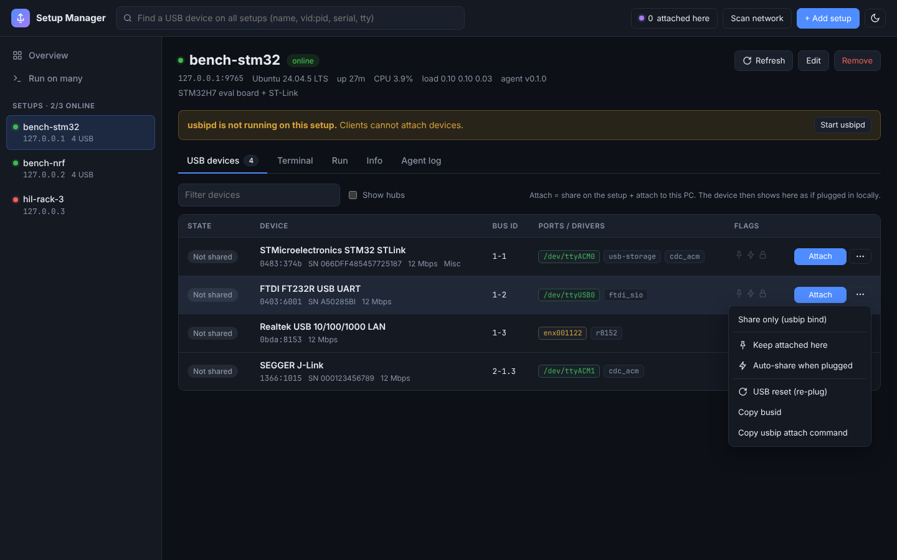

# Setup Manager

Setup Manager controls a group of Linux "setup PCs" that you use for embedded
development. Each setup PC shares its USB devices (debug probes, serial
adapters, boards) over USB/IP. With Setup Manager, you can:

- See the status of all setup PCs (online, CPU, memory, disk, IPs, usbipd).
- See the USB devices of each PC, with their tty names and USB/IP state.
- Attach a device to your PC with one click (usbip bind + usbip attach).
- Keep a device attached. The manager attaches it again after a board reset.
- Open a shell on a setup PC in the browser, or run one command on many PCs.
- Let AI agents do all of this through an MCP server.



## Parts

```
 your PC (manager)                                setup PC (one agent on each)
 +-----------------------------+   HTTP + WS     +-------------------------------+
 | setup-manager serve  (GUI)  | --------------> | setup_agent.py  (systemd)     |
 | setup-manager mcp    (MCP)  |   token auth    |   status, USB list, bind,     |
 | setup-manager <cli>         |   port 8765     |   exec, PTY shell             |
 |                             |                 |                               |
 | usbip attach / detach       | <-------------- | usbipd (USB/IP server)        |
 +-----------------------------+   USB/IP 3240   +-------------------------------+
```

| Part | Runs on | What it is |
|---|---|---|
| Agent | each setup PC | `setup_manager/agent/setup_agent.py`. One file. Python 3.8+ standard library only. Runs as root (USB bind needs root) from systemd. |
| Manager | your PC | Python package `setup-manager`. Web GUI, REST API, CLI and MCP server. The local `usbip attach` runs here. |

The GUI, the CLI and the MCP server use the same config file:
`~/.config/setup-manager/config.json` (`%APPDATA%\setup-manager\config.json` on Windows).

## 1. Install the manager (your PC)

Requirements: Python 3.10+, and the usbip client.

```bash
git clone <this repo> setup-manager && cd setup-manager
python3 -m venv ~/.venvs/setup-manager
~/.venvs/setup-manager/bin/pip install .
ln -s ~/.venvs/setup-manager/bin/setup-manager ~/.local/bin/   # optional
```

Install the usbip client and the `vhci-hcd` kernel module:

- Debian: `sudo apt install usbip`
- Ubuntu: `sudo apt install linux-tools-generic`
- Fedora: `sudo dnf install usbip`
- Arch: `sudo pacman -S usbip`
- Windows: install [usbip-win2](https://github.com/vadimgrn/usbip-win2). Set `"local_usbip": {"command": "C:\\Program Files\\USBip\\usbip.exe"}` in the config. (Not tested yet.)

`usbip attach` needs root. The manager runs `sudo -n usbip ...` when it is not root.
Let your user run usbip without a password:

```bash
echo "$USER ALL=(root) NOPASSWD: $(command -v usbip), $(command -v modprobe)" | sudo tee /etc/sudoers.d/setup-manager
sudo chmod 440 /etc/sudoers.d/setup-manager
echo vhci-hcd | sudo tee /etc/modules-load.d/vhci-hcd.conf && sudo modprobe vhci-hcd
```

## 2. Install the agent (each setup PC)

### From the manager, over SSH (recommended)

```bash
setup-manager deploy dev@192.168.1.20 --name bench-1 --install-deps
```

This copies the agent to the PC, runs the installer with sudo, and adds the
setup to the manager config with its token. To use one token for all setups,
set `agent_defaults.token` in the manager config first, or give `--token`.
Repeat for each setup PC.

### By hand

Copy the folder `setup_manager/agent/` to the setup PC (`setup-manager agent-files` prints its path), then:

```bash
sudo ./install.sh --name bench-1 --install-deps
```

The installer:

- Copies the agent to `/opt/setup-agent/` and makes `/etc/setup-agent/config.json`.
- Makes a random token if you do not give one, and prints it as `CONFIG_TOKEN=...`.
- Installs and starts two systemd services: `setup-agent` and `setup-usbipd`. They start at boot.
- Loads `usbip-host` at boot.
- Sets the shell user to the user that ran sudo (`run_as`). Shells and commands run as this user, not root.
- Opens the ports in ufw when ufw is active (8765/tcp, 8765/udp, 3240/tcp).

Options: `--token`, `--port`, `--run-as USER`, `--auto-bind RULE`, `--protect RULE`, `--tls`, `--install-deps`.
Run `install.sh` again to upgrade. It keeps the existing config. To remove: `sudo ./uninstall.sh [--purge]`.

Check the agent on the setup PC: `systemctl status setup-agent` and `journalctl -u setup-agent -f`.

## 3. Start the GUI

```bash
setup-manager            # same as: setup-manager serve
```

Open <http://localhost:8800/>. Add setups with **+ Add setup** (host, token) or
with **Scan network** (UDP broadcast, same subnet only).

| Page | What you can do |
|---|---|
| Overview | All setups with CPU and RAM. The devices attached to your PC, with Detach. The keep-attached list. |
| USB devices | One row per device: state, name, vid:pid, serial, tty names, drivers. **Attach** shares the device and attaches it to your PC. **Detach** detaches it and stops sharing. The `...` menu: share only, stop sharing, detach and keep shared, keep attached, auto-share when plugged, USB reset, copy busid. |
| Terminal | A full interactive shell (xterm.js) on the setup PC. **Pop out** opens it in a new window. The session stays open when you change tabs. |
| Run | Run one command with a timeout. Quick commands and history. **Run on many** runs a command on many setups at the same time. |
| Info / Agent log | System details, and the recent log lines of the agent. |
| Search (top bar) | Find a device on all setups by name, vid:pid, serial or tty. |

Device states:

| State | Meaning |
|---|---|
| Not shared | The setup PC uses the device. |
| Shared | Bound to usbip-host. No client has it. |
| Attached here | Attached to this PC. |
| In use elsewhere | Another client has it. **Take over** takes it (asks first). |

### Keep attached and auto-share

Debug probes and boards often re-enumerate (after flashing, after a reset).
Then the USB/IP connection drops.

- **Keep attached** (manager side): every 4 seconds, the manager checks the device and attaches it again when it is missing. It follows the device by serial number when it moves to a different USB port. The GUI server must run for this. A manual Detach turns it off.
- **Auto-share when plugged** (agent side): the agent binds matching devices by itself when they are plugged in. Rules are stored in the agent config (`auto_bind`).

Use the two together for a hands-off setup.

### Safety rules in the agent

- The agent does not bind a device that has a network interface (a USB Ethernet adapter can be the only link to the PC), a hub, or a device in `protected`, unless you use force.
- Rule format for `auto_bind` and `protected`: `1-1.2` (busid), `0483:374b` (vid:pid), `0483:*`, `0483:374b:SERIAL`.

## 4. Connect AI agents (MCP)

The MCP server uses the same config and the same logic as the GUI. Devices
attach to the PC where the MCP server runs.

Claude Code:

```bash
claude mcp add setup-manager -- ~/.venvs/setup-manager/bin/setup-manager mcp
```

Claude Desktop, Cursor and other clients (stdio):

```json
{
  "mcpServers": {
    "setup-manager": {
      "command": "/home/you/.venvs/setup-manager/bin/setup-manager",
      "args": ["mcp"]
    }
  }
}
```

For clients that use HTTP: `setup-manager mcp --http --port 8801` (streamable HTTP at `http://127.0.0.1:8801/mcp`). It has no auth. Keep it on 127.0.0.1.

Tools:

| Tool | What it does |
|---|---|
| `list_setups` | All setups with online state and USB counts |
| `setup_status` | Full status of one setup |
| `list_usb` | USB devices of a setup and their state |
| `find_usb` | Search devices on all setups (`"stlink"`, `"0483:374b"`, `"ttyACM"`) |
| `attach_usb` / `detach_usb` | Bind + attach here / detach + unbind |
| `bind_usb` / `unbind_usb` / `reset_usb` | Single actions on the setup PC |
| `keep_attached` | Turn keep-attached on or off |
| `list_attached` | Devices attached to this PC |
| `run_command` / `run_command_many` | Shell commands on one or many setups |
| `agent_log` | Recent agent log lines |

Example request to an agent: *"Find the ST-Link on the lab setups, attach it,
flash build/fw.elf with openocd, then detach it."*

## CLI

```bash
setup-manager list                       # setups and state
setup-manager usb bench-1                # USB devices
setup-manager attach bench-1 1-1.2       # bind + attach here
setup-manager detach bench-1 1-1.2       # detach + unbind (--keep-bound to keep it shared)
setup-manager attached                   # devices attached to this PC
setup-manager exec bench-1 'dmesg | tail -n 20'
setup-manager exec all -- uptime         # on every setup
setup-manager discover                   # find agents with UDP broadcast
setup-manager add 192.168.1.21 --name bench-2 --token ...
setup-manager --json usb bench-1         # JSON output for scripts
```

A setup can be given by id, name or host.

## Configuration

Manager (`~/.config/setup-manager/config.json`). All keys are optional:

```json
{
  "listen": "127.0.0.1",
  "port": 8800,
  "token": "",
  "allowed_hosts": [],
  "agent_defaults": { "port": 8765, "token": "one-token-for-all-agents" },
  "local_usbip": { "command": null, "sudo": null },
  "poll_interval": 5,
  "discovery_targets": ["255.255.255.255"],
  "setups": [
    { "id": "bench-1", "name": "bench-1", "host": "192.168.1.20", "port": 8765, "token": "...",
      "tls": false, "verify_tls": false, "usbip_port": 3240, "notes": "STM32H7 board" }
  ]
}
```

Agent (`/etc/setup-agent/config.json`): see `setup_manager/agent/config.example.json`.
Important keys: `token`, `port`, `run_as`, `auto_bind`, `protected`, `tls_cert`/`tls_key`, `discovery`.
Restart after a change: `sudo systemctl restart setup-agent`.

## Security

Read this before you use it on a shared network.

- The agent gives a **root-level** API (USB control and shell) to everyone who has its token. Keep the token secret. Each agent can have its own token.
- Without TLS, the token and the shell traffic go over the network as plain text. Use `--tls` on the agent (self-signed certificate) and `"tls": true` for the setup. Or use the agents only on a lab network that you trust.
- USB/IP (port 3240) has no authentication and no encryption. This is a limit of USB/IP. Anyone who can reach port 3240 can attach a shared device. Share devices only on a trusted network, or limit port 3240 with a firewall to your PC's IP.
- The manager listens on 127.0.0.1 by default. If you set `listen` to a network address, set `token` too. The manager blocks cross-site requests from other web pages and DNS rebinding.
- The MCP server can do everything the GUI can do. Give it only to agents that you trust with your lab.

## Troubleshooting

| Problem | What to do |
|---|---|
| Setup is offline | On the setup PC: `systemctl status setup-agent`. Check the firewall (8765/tcp). Check host and port in the manager. |
| "agent rejected the token" | The token in the manager does not match `/etc/setup-agent/config.json`. |
| "usbipd is not running" | Click **Start usbipd**, or `sudo systemctl restart setup-usbipd` on the setup PC. |
| usbip not found on the setup PC | Ubuntu: `sudo apt install linux-tools-generic linux-tools-$(uname -r)`. Debian: `sudo apt install usbip`. |
| Attach fails with "password is required" | Add the sudoers rule from step 1. |
| Attach fails with "open vhci_driver" | `sudo modprobe vhci-hcd` on your PC. |
| Attach times out | Port 3240/tcp on the setup PC is blocked. |
| Scan network finds nothing | Discovery uses UDP broadcast and works only in one subnet. Add the setups by IP. |

## Development

```bash
pip install -e '.[test]'
pytest
```

The tests run a real agent process against a fake sysfs tree with fake `usbip`
programs (`tests/fakes/`). They test the agent API, the manager, the REST API,
the WebSocket shell and the MCP server, without USB hardware or root.
The MCP server works with the `mcp` package 1.x and 2.x.
